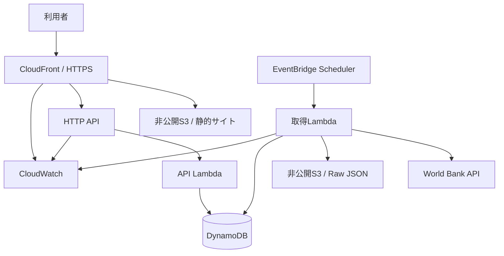

# World Data Lens

World Data Lensは、World Bank Indicators APIの公開統計を取得・整形し、主要国の比較、グラフ表示、CSV・Excel出力まで行うデータサービスです。

ローカルのFlask版と、AWSへ公開するサーバーレス版を同じリポジトリで管理しています。AWS版は、初めてAWSアカウントを作る人でも、設定ファイルを1回編集して数個のまとめコマンドを実行すれば公開できる構成です。

> 重要: このリポジトリはAWSへデプロイできる状態まで実装・検証していますが、リポジトリ作成者による実デプロイは行っていません。AWS利用料金、決済・広告事業者の審査、販売者情報、税務・法務対応は運営者が確認してください。

## 現在できること

- World Bank公式APIから主要35か国・12指標を取得
- Raw JSONをS3へ日付別に保存
- 国コード + 指標コード + 年で重複を防止
- SQLite（ローカル）またはDynamoDB（AWS）へ保存
- 国、カテゴリー、指標、期間、値で検索・絞り込み
- 時系列、地域比較、国別ランキングを表示
- 日本語Excelで開きやすいCSVをダウンロード
- `Summary`、`Data`、`Methodology`の3シートを持つExcelをダウンロード
- S3 + CloudFrontで静的WebサイトをHTTPS配信
- CloudFrontとAPIを同一ドメインの`/api/*`で利用
- EventBridge Schedulerで週1回更新
- CloudWatch Dashboard、エラー・遅延アラーム
- AWS Budgetsの通知先を設定した場合だけ月額予算を作成
- 外部決済リンクを設定した場合だけ販売ボタンを有効化
- スポンサー枠またはGoogle AdSense設定時だけ広告枠を有効化
- `dev`と`prod`で削除保護を切り替え
- GitHub Actionsでローカルテスト、CDKテスト、`cdk synth`

## 想定利用者

- 市場・競合・国別比較資料を作る企業担当者
- 企画書や提案書へ信頼できる公開統計を掲載したい人
- Excelで二次集計したいアナリスト
- AWS CDK、Lambda、DynamoDB、CloudFrontを学習したい人

## 収録データ

企業資料で使用頻度の高い分野を優先し、データ量とAWS料金のバランスから既定値を絞っています。

| カテゴリー | 指標 | World Bankコード | 単位 |
|---|---|---|---|
| 経済 | 名目GDP | `NY.GDP.MKTP.CD` | US$ |
| 経済 | 1人当たりGDP | `NY.GDP.PCAP.CD` | US$ |
| 経済 | 実質GDP成長率 | `NY.GDP.MKTP.KD.ZG` | % |
| 経済 | 消費者物価上昇率 | `FP.CPI.TOTL.ZG` | % |
| 雇用 | 失業率 | `SL.UEM.TOTL.ZS` | % |
| 貿易 | 輸出比率（GDP比） | `NE.EXP.GNFS.ZS` | % |
| 人口・社会 | 人口 | `SP.POP.TOTL` | 人 |
| 人口・社会 | 都市人口比率 | `SP.URB.TOTL.IN.ZS` | % |
| 人口・社会 | 平均寿命 | `SP.DYN.LE00.IN` | 年 |
| デジタル | インターネット利用率 | `IT.NET.USER.ZS` | % |
| 環境・エネルギー | 1人当たりCO2排出量 | `EN.ATM.CO2E.PC` | t/人 |
| 環境・エネルギー | 再生可能エネルギー比率 | `EG.FEC.RNEW.ZS` | % |

対象は日本、米国、中国、主要アジア、G7、主要欧州、中南米、中東・アフリカを含む35か国です。既定期間は2010年から現在年までです。おおむね7,000〜8,000件に収まり、年次データを毎日更新する無駄を避けるため、AWS版は週1回更新します。

カタログは[src/data_catalog.py](src/data_catalog.py)で一元管理しています。指標や国を追加するときは、データ利用条件、欠損率、更新頻度、DynamoDB書込数を確認してください。

## データ取得元と利用条件

取得元は[World Bank Indicators API](https://datahelpdesk.worldbank.org/knowledgebase/articles/889392-about-the-indicators-api-documentation)です。HTMLスクレイピングではなく公式APIを使用します。

[World Bankのデータ利用条件](https://data.worldbank.org/summary-terms-of-use)では、個別のメタデータに別条件がない限り、データは原則CC BY 4.0で再利用できます。

- サイトとダウンロードファイルに出典名・取得日時・API URLを残します。
- 有料商品の対象は、公開データそのものの独占販売ではなく、選定、整形、帳票化、定期更新、カスタム分析などの付加価値です。
- 商用資料へ利用するときは、使用する各指標のメタデータと最新の利用条件を再確認してください。
- World Data LensはWorld Bankの公式製品・提携サービスではありません。

## 全体構成



CloudFrontを入口に統一し、`/`は静的フロント、`/api/*`はAPI Gatewayへ送ります。ブラウザからS3やDynamoDBへ直接アクセスしません。

## ディレクトリ構成

```text
.
├── frontend/                       # AWSで配信する静的Webサイト
│   ├── index.html                  # ダッシュボード
│   ├── explorer.html               # 検索・CSV/Excel出力
│   ├── pricing.html                # 法人向け・販売導線
│   ├── about.html                  # 出典・プライバシー・運営情報
│   └── assets/                     # CSS / JavaScript
├── infrastructure/                 # AWS CDK v2 Python
│   ├── app.py
│   ├── deploy.env.example          # 1回編集する公開設定の見本
│   ├── stacks/
│   │   ├── data_stack.py           # S3 Raw / DynamoDB
│   │   ├── backend_stack.py        # Lambda / Scheduler / HTTP API
│   │   ├── frontend_stack.py       # S3 Frontend / CloudFront / 配備
│   │   └── monitoring_stack.py     # CloudWatch / Alarm / Budget
│   └── tests/                      # CDK Assertions
├── scripts/                        # AWS初回公開用まとめコマンド
├── src/
│   ├── acquisition/                # API取得・整形
│   ├── database/                   # SQLite Repository
│   ├── aws_database/               # DynamoDB Repository
│   ├── aws_handlers/               # Lambda Handler
│   ├── aws_runtime/                # Lambda用APIクライアント・S3保存
│   ├── exports/                    # CSV / XLSX生成
│   ├── services/                   # 更新・集計
│   └── web/                        # ローカルFlask画面
├── tests/                          # ローカル版テスト
├── Makefile                        # コマンドを短くまとめる入口
└── legacy/platformer/              # 既存ゲームの保存先
```

## AWS IaC

IaC（Infrastructure as Code）は、AWSコンソールで手作業する代わりに、インフラの構成をコードで定義・レビュー・再現する方法です。このリポジトリではAWS CDK v2のPythonコードからCloudFormationテンプレートを生成します。

AWS CDKを採用した理由:

- 既存アプリと同じPythonで記述できる
- S3、Lambda、DynamoDB間のIAM権限をCDKの`grant_*`で狭く付与できる
- dev/prodの差を同じコードで管理できる
- CDK Assertionsで、公開S3や過剰権限などをAWSへ作成する前に検査できる
- 最終的な作成・更新・削除はCloudFormationが履歴管理する

`infrastructure/`のコードを変更したときの基本確認:

```bash
make check
```

個別に確認する場合:

```bash
cd infrastructure
npx aws-cdk@2.1138.0 synth --context environment=dev
npx aws-cdk@2.1138.0 diff --context environment=dev
```

`synth`はAWS認証なしでもテンプレートを生成できます。`diff`は対象アカウントとの差分を読むため、AWS CLIログインとCDK Bootstrap後に実行します。`deploy`と`destroy`は実際のAWSリソースを変更するため、後述の手順と対象Account/Regionを確認してから実行してください。

## Excel・CSVの仕様

### Excel

Excelは外部パッケージをLambdaへ追加せず、Python標準ライブラリでXLSXを生成します。Lambda LayerやDockerが不要なため、初回デプロイと運用を簡単にしています。

| シート | 内容 |
|---|---|
| `Summary` | 生成日時、件数、検索条件、利用上の注意 |
| `Data` | オートフィルター、先頭行固定、国・指標・値・出典URL |
| `Methodology` | データ取得元、ライセンス、一意キー、各列の説明 |

### CSV

- UTF-8 BOM付き
- 日本語Excelで文字化けしにくい形式
- Excelと同じ検索条件を反映
- 出典URLと取得日時を含む

ダウンロードは最大20,000件です。それ以上の一括提供が必要な場合は、S3で事前生成したファイルを配布する方式へ変更してください。

## 販売機能

販売機能はStripe等の外部決済リンクを設定する方式です。サイトでカード番号を処理・保存しません。

初期状態では販売ボタンは問い合わせ導線になります。`WDL_BUSINESS_CHECKOUT_URL`へStripe Payment Links等のURLを設定して再デプロイすると、安全な外部決済画面へ遷移します。

販売前に必要な作業:

1. 販売事業者情報、商品内容、価格、納期、返金条件を確定
2. Stripe等で商品と決済リンクを作成
3. 決済完了後の遷移先を`https://公開URL/purchase-complete.html`へ設定
4. `infrastructure/deploy.env`へURLと表示価格を設定
5. サイトを再デプロイ

[Stripe Payment Links公式手順](https://docs.stripe.com/payment-links/create)では、コードを書かずに決済ページを作成でき、決済後に任意URLへリダイレクトできます。

現在の販売機能は「決済ページへの安全な導線」です。ログイン、契約管理、支払済みユーザーだけの自動ダウンロード、サブスクリプション権限、請求書自動発行は次フェーズです。

## 広告・スポンサー機能

広告は初期状態で無効です。

### 推奨: 直接スポンサー

`WDL_SPONSOR_TEXT`と`WDL_SPONSOR_URL`を設定すると、外部追跡スクリプトを使わずスポンサー枠を表示できます。小規模サイトでは、プライバシーと収益のバランスが良い方式です。

### Google AdSense

`WDL_ADSENSE_CLIENT_ID`と`WDL_ADSENSE_SLOT_ID`を設定すると広告枠を有効化できます。ただし、設定前に次を実施してください。

- AdSenseのサイト審査
- プライバシーポリシー更新
- 対象地域に応じたCookie同意管理/CMP
- 広告表示位置とユーザビリティ確認
- 広告事業者の最新規約確認

IDは公開用識別子ですが、Googleアカウントのパスワードや秘密情報は絶対に保存しないでください。

## ローカル版の使い方

### 初回

```bash
git clone https://github.com/Kaito-Mori0516/codex.git
cd codex
python3 -m venv .venv
source .venv/bin/activate
python -m pip install -r requirements-dev.txt
cp .env.example .env
python manage.py update
python manage.py run
```

ブラウザで`http://127.0.0.1:5000`を開きます。

### 2回目以降

```bash
cd /Users/morikaito_labo/Codex/codex
source .venv/bin/activate
python manage.py run
```

データ更新が必要なときだけ`python manage.py update`を実行します。

### ローカルURL

| URL | 内容 |
|---|---|
| `/` | ダッシュボード |
| `/data` | 検索・一覧 |
| `/charts` | グラフ |
| `/data.csv` | CSV |
| `/data.xlsx` | Excel |
| `/health` | ヘルスチェック |

# AWSへ初めて公開する手順

ここからは、AWSアカウントをまだ持っていない人向けの手順です。既に会社のAWSを利用していても、会社アカウントへ許可なくデプロイしないでください。

## 1. AWSアカウントを作る

[AWS Free Tier](https://aws.amazon.com/free/)からアカウントを作成します。

2025年7月15日以降の新規顧客向け制度では、Free Planは最長6か月、登録時100 USDと条件達成による追加分を合わせ最大200 USD相当のクレジットが案内されています。制度・対象サービスは変更されるため、登録画面と[AWS Free Tier FAQ](https://aws.amazon.com/free/free-tier-faqs/)を確認してください。

- 学習・動作確認だけならFree Planから開始できます。
- 継続的な一般公開やFree Plan対象外サービスが必要ならPaid Planへ移行します。
- クレジットがあっても、利用量と設定によって請求は発生し得ます。
- 本プロジェクトは固定費の大きいNAT Gateway、EC2、RDS、ALB、OpenSearchを使用しません。

## 2. rootユーザーを保護する

アカウント作成直後に実施します。

1. rootユーザーへパスキー、セキュリティキー、または認証アプリのMFAを登録
2. 可能なら予備のMFAも登録
3. rootのAccess Keyを作らない
4. 代替連絡先と請求連絡先を確認
5. rootはアカウント固有の作業以外に使用しない

AWSは[rootユーザーのMFA](https://docs.aws.amazon.com/IAM/latest/UserGuide/root-user-best-practices.html)と、人のアクセスには一時認証情報・IAMロールを推奨しています。

## 3. IAM Identity Centerで自分用ログインを作る

会社AWSで使ったAccess Portalと同じ考え方です。個人の新規アカウントでも、rootを日常利用しないためにIAM Identity Centerを使います。

1. AWSコンソールのリージョンを東京`ap-northeast-1`へ変更
2. `IAM Identity Center`を開く
3. `Enable`を選択
4. 個人利用でも、将来の複数アカウント管理を考える場合はOrganization instanceを選択
5. 自分のユーザーを作成しMFAを設定
6. 初回構築用のPermission Setを作成
7. AWSアカウントへ自分とPermission Setを割り当て

初回CDKデプロイには多種類のAWSリソースとIAMロール作成が必要です。最初は管理者相当Permission Setを使用し、構築後は日常確認用の読み取り権限とデプロイ権限を分離してください。

[IAM Identity Centerの有効化手順](https://docs.aws.amazon.com/singlesignon/latest/userguide/enable-identity-center.html)では、スタンドアロンアカウントでも有効化できます。

## 4. MacへAWS CLIを入れる

Apple Silicon MacではHomebrewを使います。

```bash
brew install awscli node
aws --version
node --version
python3 --version
```

Pythonは3.12以上を推奨します。現在確認済みのPython 3.12.14で実行できます。

## 5. AWS CLIをAccess Portalへ接続する

IAM Identity CenterのAWS access portal URLを確認して実行します。

```bash
aws configure sso
```

入力例:

| 質問 | 入力例 |
|---|---|
| SSO session name | `world-data-lens` |
| SSO start URL | Access Portal URL |
| SSO region | IAM Identity Centerを作ったリージョン |
| SSO registration scopes | そのままEnter |
| AWS account | 今回作成した個人アカウント |
| Role / Permission Set | 初回構築用の権限 |
| CLI default region | `ap-northeast-1` |
| CLI output format | `json` |
| Profile name | `world-data-lens` |

ブラウザ認証後、次で確認します。

```bash
aws sso login --profile world-data-lens
aws sts get-caller-identity --profile world-data-lens
```

AccountとArnが表示され、Arnの末尾が`:root`でなければ進めます。

## 6. リポジトリと依存パッケージを準備する

```bash
cd /Users/morikaito_labo/Codex/codex
git switch main
git pull
make setup
make check
```

`make check`はローカルテスト、CDKテスト、CloudFormation生成をまとめて行います。

## 7. 公開設定を1回だけ記入する

```bash
cp infrastructure/deploy.env.example infrastructure/deploy.env
open -e infrastructure/deploy.env
```

最低限、次を設定します。

```text
AWS_PROFILE=world-data-lens
AWS_REGION=ap-northeast-1
WDL_OPERATOR_NAME=運営者名
WDL_CONTACT_EMAIL=公開用メールアドレス
WDL_ALARM_EMAIL=障害通知を受け取るメール
WDL_BUDGET_EMAIL=予算通知を受け取るメール
```

販売・広告をまだ開始しない場合、その他は空欄のままで構いません。`deploy.env`はGit管理されません。

## 8. 最短: まとめてdev環境を公開する

初回Bootstrap、テスト、デプロイ、初回データ取得、URL表示を1コマンドにまとめています。

```bash
make aws-launch-dev
```

確認画面が出た場合は、作成対象とIAM変更を読み、問題がなければ承認します。CloudFrontの反映には数分かかることがあります。

以下の9〜12は、各工程を個別に実行・再実行したい場合の説明です。最短手順では実行済みなので飛ばせます。

実行前チェック:

- AWS CLIのArnが`:root`ではない
- `AWS_PROFILE`と`AWS_REGION`が個人の対象アカウントを指す
- Budget通知メールを設定した
- `git status`に`.env`、`deploy.env`、Access Keyが含まれていない
- `make check`が成功する
- devから開始し、作成予定リソースとIAM差分を確認する
- AWS料金、World Bank利用条件、公開する運営者情報を確認する

## 9. CDK Bootstrapを個別実行する

アカウントとリージョンにつき原則1回です。

```bash
make aws-bootstrap
```

CDKがCloudFormationテンプレートやデプロイ資材を置くためのS3/ECR/IAMリソースを作ります。

## 10. dev環境を個別に公開する

```bash
make aws-deploy-dev
```

このコマンドは次をまとめて実行します。

1. root認証でないことを確認
2. 全テスト
3. `cdk synth`
4. CDK deploy前のIAM変更確認
5. 4つのCloudFormation Stackをデプロイ
6. 静的フロントをS3へ配置
7. CloudFrontキャッシュを更新

確認画面が出た場合は、作成対象を読み、問題がなければ承認します。

## 11. 初回データを個別に入れる

```bash
make aws-seed-dev
```

最初の更新Lambdaを1回実行します。以後はEventBridge Schedulerが週1回更新します。

## 12. 公開URLを確認する

```bash
make aws-url
```

表示されたCloudFront URLをブラウザで開きます。デプロイ直後はCloudFront反映に数分かかることがあります。

確認項目:

- ダッシュボードの件数と更新日時
- 指標・国を変えたときのグラフ
- データ検索とページ移動
- CSVがExcelで文字化けしないこと
- Excelの3シートと出典URL
- `公開URL/api/health`が`status: ok`

## 13. prod環境へ進める

devで確認後に実行します。

```bash
./scripts/aws_deploy.sh prod
./scripts/aws_seed.sh prod
./scripts/aws_outputs.sh prod
```

`prod`はS3バージョニング、DynamoDB PITR、削除保護、`RETAIN`を有効化します。`cdk destroy`してもデータが自動削除されないため、残存料金と削除手順を別途管理してください。

## 作成されるAWSリソース

| Stack | 主なリソース | 役割 |
|---|---|---|
| Data | S3 Raw、DynamoDB | Raw保存と検索用データ |
| Backend | 取得Lambda、API Lambda、HTTP API、Scheduler | 更新・検索・出力 |
| Frontend | 非公開S3、CloudFront、OAC、静的ファイル配備 | HTTPSサイト配信 |
| Monitoring | Dashboard、Alarm、任意Budget/SNS | 障害・料金監視 |

すべてに`Project=WorldDataLens`、`Environment=dev/prod`、`ManagedBy=CDK`タグを付与します。

## API

CloudFront公開URLの配下で利用します。

| Method / Path | 内容 |
|---|---|
| `GET /api/health` | 稼働・件数 |
| `GET /api/summary` | ダッシュボード概要 |
| `GET /api/catalog` | 国・指標・カテゴリー |
| `GET /api/data` | 検索・並び替え・ページ分割 |
| `GET /api/countries` | 対象国 |
| `GET /api/indicators` | 対象指標 |
| `GET /api/charts/timeseries` | 時系列 |
| `GET /api/charts/ranking` | ランキング |
| `GET /api/charts/overview` | グラフ一式 |
| `GET /api/export.csv` | 条件反映CSV |
| `GET /api/export.xlsx` | 条件反映Excel |

APIは公開統計の読み取り専用です。HTTP APIの直接URLも生成されますが、通常はCloudFront URLだけを案内します。

## DynamoDB設計

### Primary Key

```text
pk = COUNTRY#{country_code}#INDICATOR#{indicator_code}
sk = YEAR#{year}
```

国 + 指標 + 期間の取得をQueryで処理し、ローカル版の`country_code + indicator_code + year`一意制約を維持します。

### GSI

```text
gsi1pk = INDICATOR#{indicator_code}
gsi1sk = YEAR#{year}#COUNTRY#{country_code}
```

指標別時系列、同一年の国比較、ランキングを1つのGSIで処理します。GSIを増やしすぎず、カテゴリーや所得区分は取得後の小規模フィルターで処理します。

Billing Modeは`PAY_PER_REQUEST`です。アクセスが少ない学習・立ち上げ期に固定キャパシティ料金を持たず、急な小規模アクセスにも対応できます。

更新時は既存値と同じレコードを再書込みしません。World Bankの年次データが変化していない週は、DynamoDB書込数を大きく抑えます。

## IAM設計

| 実行主体 | 許可 |
|---|---|
| 取得Lambda | 対象Raw BucketへのPut、対象TableへのGet/Put/Update/BatchWrite |
| API Lambda | 対象TableのReadのみ |
| Scheduler Role | 対象取得LambdaのInvokeのみ |
| CloudFront | OAC経由のFrontend Bucket Getのみ |

`AdministratorAccess`、`iam:*`、S3/DynamoDBの削除権限はLambdaへ付与しません。

## セキュリティ

- S3 Public Access Block
- S3暗号化・HTTPS通信のみ
- CloudFront OAC
- CloudFront HTTPSリダイレクト
- HSTS、CSP、`X-Content-Type-Options`、frame拒否、Referrer Policy
- API Gatewayスロットリング
- Lambda責務別Role・最小権限
- root Access Key禁止
- `.env`、`deploy.env`、AWS認証情報、DB、`cdk.out`をGit除外
- 決済情報をサイトで扱わず外部決済ページへ遷移
- ログへ秘密情報や利用者データを出さない

WAFは固定費と構築リージョンの複雑さを避けるため、CDKの既定構成には含めていません。一般公開後に攻撃・Bot・高トラフィックが増えた場合は、CloudFront WAFまたはCloudFrontの料金プランを比較して追加します。

## 監視と日常運用

### 自動監視

- 取得Lambdaエラー
- 取得Lambdaが10分タイムアウトへ近づいた場合
- API Lambdaエラー
- HTTP API 5xx
- Scheduler起動失敗
- CloudFront 5xx率
- Lambda時間、API応答、CloudFrontリクエストのDashboard

ログ保持は既定14日です。通知メールを設定した場合、SNS確認メールの`Confirm subscription`を押すまで通知は届きません。

### 日常の更新

通常は操作不要です。World Bankの年次統計に合わせ週1回更新します。

手動更新:

```bash
make aws-seed-dev
```

コード更新:

```bash
git pull
source .venv/bin/activate
make check
make aws-deploy-dev
```

## 料金の考え方

AWS料金はリージョン、転送量、リクエスト、ログ、ダウンロードファイルサイズで変わります。以下は固定価格ではなく確認目安です。

| 利用状況 | 主な料金要因 | 目安の考え方 |
|---|---|---|
| ほぼアクセスなし | S3少量、週次Lambda、CloudWatch Logs | Free Tier/クレジット内ならほぼ0 USDの可能性。Budgetで監視 |
| 月1万PV | CloudFront転送、API/Lambda数万回 | キャッシュが効けば小額。多くの場合は数USD以内を目標 |
| 月10万PV | 転送量、Excel出力回数、API回数 | 数USD〜数十USDの可能性。実測後にキャッシュ・事前生成を検討 |

[AWS Lambda](https://aws.amazon.com/lambda/pricing/)は月100万リクエストと400,000 GB秒の無料枠を案内しています。[API Gateway](https://aws.amazon.com/api-gateway/pricing/)も新規顧客向けHTTP API無料枠を案内しています。DynamoDB Standardは[最初の25 GBストレージ無料枠](https://aws.amazon.com/dynamodb/pricing/)が案内されています。

CloudFrontは従量課金に加え、2026年時点で0 USDからの定額プランも案内されています。ただし他のプロモーションと併用できない場合があるため、[CloudFront料金ページ](https://aws.amazon.com/cloudfront/pricing/)でFree Tierクレジットとの比較を行ってください。

本番前に[AWS Pricing Calculator](https://aws.amazon.com/calculator/)で東京リージョンの最新単価を確認します。Stripe等の決済手数料、広告事業者、独自ドメインはAWS料金とは別です。

## 料金事故を防ぐ設定

1. `WDL_BUDGET_EMAIL`を設定して月5 USD Budgetを作る
2. Billing and Cost Managementで請求アラートを確認
3. Free Tier使用量とクレジット残高を毎週確認
4. CloudWatchログを14日で削除
5. Raw JSONはdev 90日、prod 365日で期限切れ
6. 年次データを週1回だけ更新
7. 未使用dev環境は削除する

[AWS Budgets料金](https://aws.amazon.com/aws-cost-management/aws-budgets/pricing/)では最初の2つのaction-enabled budgetが無料と案内されています。通常の予算通知についても作成画面の最新表示を確認してください。

## dev環境を削除する

削除は料金停止につながる重要操作です。対象AccountとRegionを確認してから実行します。

```bash
cd infrastructure
npx aws-cdk destroy --all --context environment=dev
```

devは`DESTROY`と`auto_delete_objects`を使うため、S3・DynamoDBデータも削除されます。prodは`RETAIN`と削除保護を使うため、別途データ保全・削除判断が必要です。

## テスト

まとめて実行:

```bash
make check
```

個別実行:

```bash
source .venv/bin/activate
python -m pytest -q
cd infrastructure
python -m pytest -q
npx aws-cdk@2.1138.0 synth --context environment=dev
```

テストでは次を確認します。

- API取得・エラー処理・整形
- SQLite/DynamoDBの重複防止
- 集計
- CSV BOM・Excel内部構造
- Flaskルート
- Lambda Adapter・API・ファイル出力
- S3非公開・暗号化・HTTPSのみ
- DynamoDB PAY_PER_REQUEST・GSI
- Python 3.12 Lambda
- EventBridge Scheduler
- API Gateway HTTP API
- CloudFront OAC・API Behavior・セキュリティヘッダー
- IAMにAdministratorAccessや削除権限がないこと
- CloudWatch Alarm・Budgetの条件付き作成

## 環境分離

| 項目 | dev | prod |
|---|---|---|
| S3削除 | destroy時に削除 | retain |
| Raw versioning | 無効 | 有効 |
| DynamoDB削除保護 | 無効 | 有効 |
| DynamoDB PITR | 無効 | 有効 |
| 用途 | 学習・検証 | 一般公開 |

Stack名、タグ、Scheduler名へ`dev`/`prod`を含めます。S3 Bucket名はCloudFormation生成に任せ、グローバルな名前衝突を避けます。

## 独自ドメインを追加する場合

現在はCloudFrontの標準URLだけで公開できます。独自ドメインは別フェーズです。

1. Route 53または外部レジストラでドメイン取得
2. ACM証明書を`us-east-1`で発行
3. CloudFrontへ証明書とドメインを設定
4. DNSをCloudFrontへ向ける
5. 決済リンク、広告審査、CORS、利用規約のURLを更新

## 現在まだ自動化していないこと

- AWSアカウント作成、MFA、IAM Identity Center設定
- AWSへの実デプロイ
- 独自ドメイン、Route 53、ACM
- WAF
- Stripe/AdSenseアカウント作成・審査
- 決済後の自動権限付与・サブスクリプション管理
- 特定商取引法等の販売者表示、税務・法務レビュー
- EEA等向け広告Cookie同意管理
- PowerPointの直接生成
- SLA、24時間有人監視、サポート窓口

「企業立ち上げができるレベル」とは、技術的に公開・検索・出力・販売導線・広告設定・監視を開始できる状態を指します。実際の事業開始には、販売条件、個人情報保護、契約、税務、問い合わせ運用、データ品質責任を運営者が整備してください。

## Gitと秘密情報

Git管理しないもの:

```text
.env
.venv/
infrastructure/deploy.env
infrastructure/cdk.out/
__pycache__/
*.db
AWS Access Key / Secret Access Key
決済事業者のSecret Key
```

公開してよい設定だけがCloudFrontの`config.json`へ入ります。AWS Account IDをソースコードへ固定していません。

## ライセンスと免責

アプリケーションコードの利用条件と、World Bankデータの利用条件は別です。World Bankデータを再配布・販売物へ利用するときは、個別指標のメタデータと最新の利用条件を確認してください。

本サービスの集計・ランキングは説明資料作成を補助するもので、投資、融資、政策、法務その他の専門判断を代替しません。
